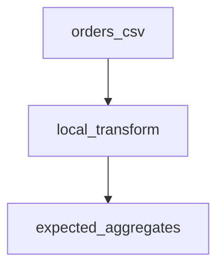
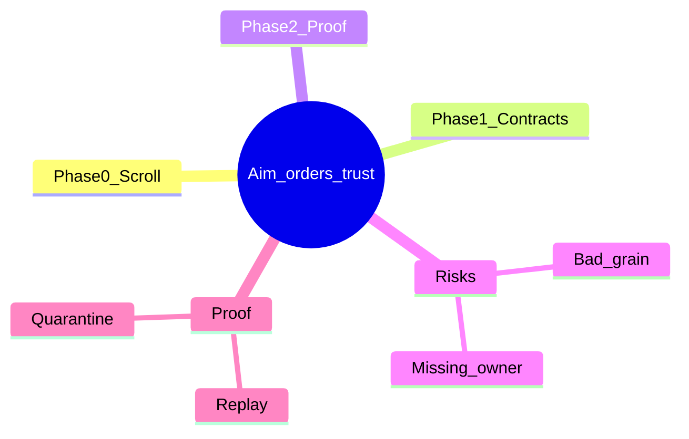

# Example campaign plan (illustrative)

Replace every placeholder from a real Scroll. This file is a shape sample, not a real fight.

## Aim of this fight

**Title:** Local orders reconciliation (example)  
**Aim:** The ops lead can trust daily order totals before the Monday stand-up.  
**Single action:** Reconcile local orders to expected aggregates with a failing test first.  
**Owner:** Ops lead, Monday morning.

## Locked defaults

- Presentation: local files and DuckDB demo only (example terrain).
- No cloud warehouse assumed.
- Human approve before anything “production.”

## Non-goals

- No vendor platform migration.
- No natural-language query.
- No enterprise-wide rollout.

## Architecture flowchart

## Mind map

## Evidence on the terrain

| Source | What it teaches | Status |
| --- | --- | --- |
| `demos/local_orders/` | Local transform + aggregates pattern | observed (in agent repo) |
| Scroll ground gate | Decision, owner, single action | required before this plan |

## Phases

### Phase 0 — Decision on the Scroll
**Pass gate:** Ground questions 1–6 answered.  
**Stop until gate:** No `PLAN.md` fiction; no build.

### Phase 1 — Contract notes
**Pass gate:** Grain, keys, and pass/fail checklist written.  
**Stop until gate:** No API or UI work.

### Phase 2 — Smallest proof
**Pass gate:** Recorded failing then passing test for the single action.  
**Stop until gate:** No second feature.

## Suggested build order

1. Scroll + this plan  
2. Contract checklist  
3. Failing proof  
4. Thin implementation  
5. Stop for human approve  

## First concrete execution after plan approval

Create `spec.md` via `/to-spec` for the single action only. Do not scaffold a platform.

## Open assumptions and falsifiers

- Assumption: sample files match production grain (label if unknown).  
- Falsifier: if quarantine rules are undefined, stop and ask.
