# Foundation Development target architecture

**Status:** Built and operating in **Foundation Development**; promoted subset to **Foundation** prod twin  
**Decision basis:** D13, D15, D1 (Salesforce in Foundation stack), D4 (shared analytics lakehouse)

## Executive picture

Foundation collapses the legacy 90-pipeline Enterprise model into:

- **~17 pipelines** (metadata-driven stage + domain refresh + utilities)
- **1 conformed warehouse** (`warehouse_stage`) with schemas `raw`, `control`, `transform`, `analytics`
- **1 shared presentation lakehouse** (`lake_house_analytics`) for all domains
- **dbt project `foundation`** as the analytics contract owner
- **Deployment pipeline** Foundation Development → Foundation

```mermaid
flowchart LR
  subgraph raw [raw folder]
    HB[HBLive shortcuts]
    BP[BuildPro shortcuts]
    SP[SPLive shortcuts]
    DV[dataverse shortcuts]
    ZO[lake_house_zonda]
    WEB[lake_house_web]
  end
  subgraph stage [stage folder]
    WH[warehouse_stage]
    ORCH[pipeline_stage_orchestrator]
  end
  subgraph tr [transform schema]
    ENT[company lot sale job ...]
    DET[general_ledger_det lot_financials_det ...]
  end
  subgraph an [analytics schema dbt]
    VIEWS[entity + report views]
  end
  subgraph lh [lake_house_analytics]
    OPS[operations Delta]
    FIN[finance tables]
    TTL[title tables]
  end
  subgraph pres [analytics folder presentation]
    SM[semantic_model_*]
    RPT[report_*]
  end
  raw --> ORCH --> tr
  tr --> dbt[dbt foundation]
  dbt --> VIEWS
  VIEWS --> REF[pipeline_operations_analytics_refresh]
  REF --> lh
  lh --> SM --> RPT
```

## Workspace folder layout (D13)

| Folder | Layer | Contents |
|---|---|---|
| `raw` | Raw | Shortcut lakehouses: HBLive, BuildPro, SPLive, dataverse_gbpdev, lake_house_zonda, lake_house_buildermetrix (D18), lake_house_web (D19) |
| `stage` | Stage | `warehouse_stage`, `pipeline_stage_orchestrator`, optional `pipeline_stage_wave_runner` |
| `analytics/<department>` | Presentation | Finalized semantic models, reports, data agents only |
| `analytics/operations` | Presentation | CustSat, lot events, sales, web listings, competitor analysis |
| `analytics/finance` | Presentation | Executive and weekly models |
| `analytics/Title` | Presentation | `semantic_model_title_booking` |
| `analytics/Mortgage` | Presentation | **Empty placeholder** (Encompass not yet in stack) |
| `analytics/HR`, `Marketing`, `Land`, `IT` | Presentation | Empty placeholders |
| `analytics/Builders/<OU>` | Presentation | Per homebuilder OU folders (presentation only) |
| `utilities` | Platform | SQL runner, audit cleanup, mirror compare, dbt job, backup cleanup, Zonda load |
| `utilities/salesforce` | Integration | `warehouse_salesforce`, `lake_house_salesforce`, SF pipelines |

Do not place unfinished transforms or platform jobs directly under `analytics`.

## Warehouse schemas (`warehouse_stage`)

| Schema | Role |
|---|---|
| `raw` | Typed landing for web scrape and similar (`web_listing_det`, ...) |
| `control` | `stage_load_config`, `analytics_refresh_config`, audit tables, web scrape registry |
| `transform` | Conformed tables + `sp_load_*` procs (D13 names) |
| `analytics` | dbt-built views consumed by refresh pipeline |

**Note (Confirmed):** FD `raw` and `stage` schemas in the warehouse are largely **empty**; transform procs read **shortcut lakehouses** cross-database (same pattern as EDW reading mirrors). This is verified in the D13 parity eval.

## Stage orchestration (Confirmed 2026-08-27)

`pipeline_stage_orchestrator` (~9 activities):

1. Guard against overlapping runs  
2. Audit start  
3. Lookup active rows from `control.stage_load_config` ordered by `run_wave`  
4. Sequential ForEach executing `transform.sp_load_*`  
5. Audit end  

Wave order (Confirmed DAG): company/division/OU/... → job → sale → lot → SGM assumptions → lot SGM.

Parameters:

- `p_run_group = 'history'` for snapshot loads  
- `p_load_type_override = 'FULL'` for full rebuilds  

## Analytics pipeline

`pipeline_operations_analytics_refresh`:

- Parameter `p_domain`: `shared` | `operations` | `finance` | `title` | `all`  
- Reads `control.analytics_refresh_config`  
- Materializes dbt views to `lake_house_analytics.operations` (and domain tags as configured)

**35 published lakehouse tables** per gold-to-dbt map (2026-08-19 contract).

## Deployment pipeline (Confirmed)

| Stage | Workspace | ID (excerpt) |
|---|---|---|
| Development | Foundation Development | `40502864-...` |
| Production | Foundation | `7c1850c1-...` |

Promote copies artifacts; post-promote scripts rebind SQL endpoints and semantic model hosts. **Schedules default OFF** until hydration go-ahead.

## Foundation vs legacy (at a glance)

| Dimension | GBP-Enterprise | Foundation Development |
|---|---|---|
| Stage store | `EDW_Silver` | `warehouse_stage.transform` |
| Analytics store | `EDW_Gold` views | dbt `analytics.*` → `lake_house_analytics` |
| Pipelines | ~90 (6 live) | ~17 (metadata-driven) |
| Table naming | dim_/fact_/vw_ | D13 descriptive + shape markers |
| Git / promote | Manual twin | Deployment pipeline + ADO git repo |
| Salesforce | Enterprise WH | `utilities/salesforce` in Foundation stack (D1) |

## Governance

**Foundation Governance** workspace (D17): auditor guide notebook, RBAC inventory, read-only capture to `lake_house_governance`. Not used for presentation reports.

Purview catalog: planned, not provisioned ([`../operations/purview-catalog.md`](../operations/purview-catalog.md)).
