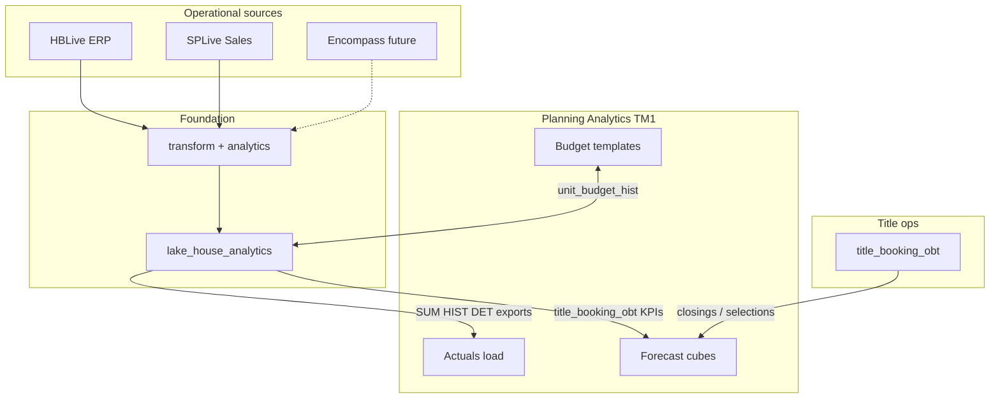

# Title, Mortgage, and planning (TM1) integration

**Purpose:** Explain how Title and Mortgage domains fit the Foundation layers and how they relate to corporate planning processes (commonly **IBM Planning Analytics / TM1** at homebuilders).

**Evidence note:** Title analytics are **Confirmed built** in Foundation Development. Mortgage and TM1 process detail are **partially open** in this repository; TM1-specific cube names and job schedules must be confirmed by Green Brick Finance / IT.

## Title domain (Confirmed in Foundation)

### Source systems

| Source | Fabric access | Role in Title |
|---|---|---|
| **SPLive** (NewStar Sales) | Shortcut lakehouse | Buyer selections, co-buyers, prospect data (`BuyerCoBuyers`, `ProspectCoBuyers`, `AllSelections`, ...) |
| **HBLive** (NewStar ERP) | Shortcut lakehouse | Operating units, projects, phases, addresses |
| **BuildPro** | Shortcut lakehouse | Adjacent construction context where joined in transform |

Title booking OBT SQL references `[SPLive].[dbo].*` and HBLive unit/project tables (Confirmed in `dbt/models/analytics/title_booking_obt.sql`).

### Layer path (Title)

```
SPLive + HBLive (raw shortcuts)
  -> transform.sale, transform.lot, transform.project, ... (shared entities)
  -> dbt analytics.title_booking_obt (view)
  -> dbt analytics.title_communities_det (view)
  -> pipeline_operations_analytics_refresh (p_domain=title)
  -> lake_house_analytics.operations.title_booking_obt
  -> lake_house_analytics.operations.title_communities_det
  -> semantic_model_title_booking (analytics/Title)
```

| Analytics object | Shape | Grain | Domain tag |
|---|---|---|---|
| `title_booking_obt` | OBT | `selection_id` | title |
| `title_communities_det` | DET | Community / booking map | title |

Legacy Gold names `vw_rep_title_booking` and `vw_rep_title_communities` map to these D13 targets.

### Title out of scope for vendors (unless explicitly added)

- Rebuilding Title SM DAX from scratch without parity checklist  
- Writing back to SPLive or HBLive  
- Cutover of Finance legacy Title reports without Green Brick sign-off

## Mortgage domain (Planned / open)

### Current state (Confirmed gaps)

| Item | Status |
|---|---|
| Encompass on `gbpsql01` | Exists on Azure SQL |
| DataSources mirror | **Not present** (decision D3 open, deferred) |
| `analytics/Mortgage` folder in FD | **Empty placeholder** |
| dbt mortgage models | **None in repo** |
| Transform procs reading Encompass | **None observed** |

### Expected future path (Inferred target; not built)

```
Encompass (Azure SQL)
  -> mirror or lake_house_mortgage (raw)
  -> transform.<mortgage entities>_det / _obt (TBD with vendor)
  -> dbt analytics.<mortgage models>
  -> lake_house_analytics (finance or mortgage domain tag TBD)
  -> semantic_model_mortgage_* under analytics/Mortgage
```

Vendor discovery must define:

- Loan application / funding grain (OBT vs DET)  
- Join keys to `sale`, `lot`, `job` (likely via SPLive selection / job keys already in `sale_obt`)  
- PII and retention policy  
- Refresh cadence vs Title booking

### Sale entity bridge (Confirmed today)

`transform.sale` / `sale_obt` already carry mortgage-adjacent fields from SPLive/HBLive (for example `loan_type`, `loan_officer_email`, `title_company`). Mortgage LOS integration would extend or replace these with Encompass-native facts.

## Planning / TM1 processes (Inferred model)

**TM1** (IBM Planning Analytics) is the usual corporate planning tool for homebuilder budgets, unit counts, and margin forecasts. This repository does **not** document TM1 job names, cubes, or TurboIntegrator scripts. The following is the **intended Fabric-side contract** for feeds that planning processes consume.

### What Foundation already publishes for planning-like use

| Fabric table | Shape | Planning use (Inferred) |
|---|---|---|
| `unit_budget_hist` | HIST | Unit budget snapshots (from legacy UnitBudgets2025 harvest) |
| `sales_sum_monthly` | SUM | OU + month; documented as budget grain |
| `sales_sum_weekly` | SUM | Operational pacing vs budget |
| `unit_sum_weekly` | SUM | Inventory / starts pacing |
| `lot_sales_gross_margin_det` | DET | Margin detail for finance variance |
| `general_ledger_det` | DET | Actuals for GL tie-out |
| `sales_gross_margin_assumptions_det` | DET | Assumption drivers (Dataverse-backed in transform) |
| `company`, `division`, `operating_unit`, `fiscal_period` | entity | Planning dimensions |

### Recommended interaction pattern (to be validated with Finance)



### Title ↔ planning (Inferred)

Title booking OBT supports:

- Selection and closing pipeline counts by operating unit  
- Community-level booking maps (`title_communities_det`)  
- Coordination with **sales_sum_*** and **unit_sum_*** for pacing dashboards  

TM1 processes that today consume Title metrics from legacy Gold should rebind to `title_booking_obt` at cutover (Confirmed SM exists: `semantic_model_title_booking`).

### Mortgage ↔ planning (Inferred; future)

When Encompass is mirrored:

- Loan pull-through and funded volume by OU/month likely feed **SUM** tables or direct TM1 actuals loads  
- Join path: Encompass loan id ↔ `sale` / selection keys (discovery required)  
- Do not duplicate loan detail in TM1; keep DET in Fabric, aggregate to planning grain in SUM or TM1 rules

### TM1 vendor questions (Green Brick to answer)

1. Which TM1 cubes / processes consume Title booking today (names and grain)?  
2. Which processes consume unit budgets vs actual sales vs GL?  
3. Is planning one-way (Fabric → TM1) or bidirectional for budgets?  
4. Required latency (daily vs intraday vs monthly)?  
5. Export format (CSV to ADLS, ODBC, PAfE dataset, custom TI)?

## Refresh domains

`pipeline_operations_analytics_refresh` parameter `p_domain`:

| Value | Includes |
|---|---|
| `shared` | calendar, company, division, OU, fiscal_period, entities |
| `operations` | lot_events_obt, sale_obt, CustSat, web models, ... |
| `finance` | GL, SGM, unit_budget_hist, ... |
| `title` | title_booking_obt, title_communities_det |
| `all` | Full materialization (used in hydration smokes) |

Planning feeds should declare which domain tags they require before enabling schedules.

## Related decisions

| ID | Topic |
|---|---|
| D3 | Encompass mirroring deferred |
| D11 | Dataverse gbpdev name kept for SGM procs until cutover |
| D14 | HIST tables keep EDW SCD2 pattern |
| D15 | Single `lake_house_analytics` for all domains |
