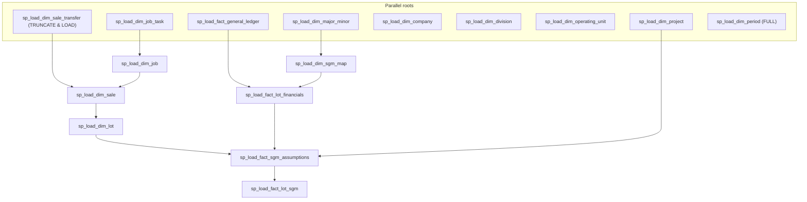
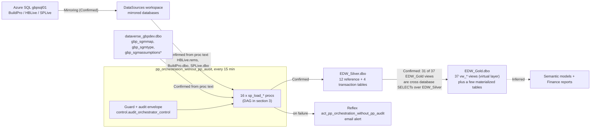

# End to end lineage: pp_orchestration_without_pp_audit

**Documented:** 2026-08-05  
**Subject:** the live production orchestrator, GBP-Enterprise.Workspace  
**Pipeline ID:** `9e2c73c1-f252-46f2-bafe-18958855d572`  
**Evidence:** full pipeline definition (fetched live 2026-08-04), schedules API, jobs API, Reflex definitions. Everything below is Confirmed unless labeled Inferred or Pending.

---

## 1. Trigger

| Property | Value |
|---|---|
| Schedule | Cron, every 15 minutes, Central Standard Time |
| Window | 2025-12-22 to 2026-12-31 (enabled) |
| Owner | User `408ae9e9-1cfd-4c4f-b0b9-80846e0a6f13` |
| Failure alerting | Reflex `act_pp_orchestration_without_pp_audit` watches this pipeline (email to individuals, see `pipelines/schedule-truth-table.md`) |

The schedule expires 2026-12-31. If it is not renewed before then, the entire stage refresh stops (same failure mode that silently killed audit cleanup and history loads on 2025-12-31).

## 2. Run envelope (control flow, in order)

1. **`check_last_run_status`** (Lookup): `SELECT COUNT(orchestrator_audit_id) AS running_count FROM EDW_Silver.control.audit_orchestrator_control WHERE run_status = 'RUNNING'`
2. **`generate_audit_key_and_start_time`** (Lookup): generates `orchestrator_audit_id` (BIGINT from NEWID + GETDATE) and `start_time`
3. **`pipeline_start_audit_log`** (Script): INSERT into `control.audit_orchestrator_control` with `run_status = 'RUNNING'`
4. **`If Condition1`**: if `running_count = 0`, run the 16 proc DAG (section 3); otherwise **Fail** with error code 4000, "The previous run is still in progress !"
5. **`conditionally_update_pp_audit`** (runs on Skipped, Succeeded, or Failed of step 4): if no proc failed, UPDATE the audit row as success (reading `avg_runtime_seconds` from `control.vw_pipeline_performance_summary`); if any failed, UPDATE with the concatenated failed activity names, then **Fail** the pipeline with code 004 "Inner table load activity failed". If the end UPDATE itself fails, the RUNNING audit row is DELETEd (`delete_blocked_log_*`) so the parallel-run guard does not deadlock future runs.

## 3. The proc DAG (16 stored procedure calls)

Activity names say `sp_call_*`, but every activity calls `[dbo].[sp_load_*]` in `EDW_Silver` directly. There are no `sp_call_*` procs. All calls: 10 minute timeout, 0 retries, connection `EDW_Silver` (DataWarehouse type, artifact `afcce380-11a2-4e14-8bd4-89f731a30848`, endpoint `cx2knzbh2yrejngvheequwseqy-mpsfzbl7atie7hr6l3lpvtholy.datawarehouse.fabric.microsoft.com`).

### Per-entity parameters

Every proc receives the same four parameters:

| Parameter | Value | Note |
|---|---|---|
| `JobRunId` | `@pipeline().RunId` | Fabric run GUID |
| `OrchestratorAuditId` | output of `generate_audit_key_and_start_time` | ties every proc run to the orchestrator audit row |
| `AuditId` | `@string(variables('v_pipeline_audit_id'))` | **variable is never set; procs receive empty string** |
| `LoadType` | `@variables('v_load_type')` for 14 of 16 | **variable is never set; procs receive empty string.** Exceptions: `dim_sale_transfer` hard-coded `TRUNCATE & LOAD`, `dim_period` hard-coded `FULL` |

Interpretation (Inferred, verify with proc text): an empty `LoadType` makes each proc fall back to its internal watermark logic (incremental). The two hard-coded exceptions are full rebuilds every 15 minutes.

### Targets written (Confirmed table set, with future names)

| Proc | Writes | Future name (rename map) |
|---|---|---|
| `sp_load_dim_company` | `dbo.dim_company` | `company` |
| `sp_load_dim_division` | `dbo.dim_division` | `division` |
| `sp_load_dim_operating_unit` | `dbo.dim_operating_unit` | `operating_unit` |
| `sp_load_dim_period` | `dbo.dim_period` | `fiscal_period` |
| `sp_load_dim_project` | `dbo.dim_project` | `project` |
| `sp_load_dim_job_task` | `dbo.dim_job_task` | `job_task` |
| `sp_load_dim_job` | `dbo.dim_job` | `job` |
| `sp_load_dim_sale_transfer` | `dbo.dim_sale_transfer` | `sale_transfer` |
| `sp_load_dim_sale` | `dbo.dim_sale` | `sale` |
| `sp_load_dim_lot` | `dbo.dim_lot` | `lot` |
| `sp_load_dim_major_minor` | `dbo.dim_major_minor` | `major_minor` |
| `sp_load_dim_sgm_map` | `dbo.dim_sgm_map` | `sales_gross_margin_map` |
| `sp_load_fact_general_ledger` | `dbo.fact_general_ledger` | `general_ledger_det` |
| `sp_load_fact_lot_financials` | `dbo.fact_lot_financials` | `lot_financials_det` |
| `sp_load_fact_sgm_assumptions` | `dbo.fact_sgm_assumptions` | `sales_gross_margin_assumptions_det` |
| `sp_load_fact_lot_sgm` | `dbo.fact_lot_sgm` | `lot_sales_gross_margin_det` |

Not in the DAG: `sp_load_dim_date` (`calendar` has no producer, confirmed gap), the three `_hist` tables (their chain expired 2025-12-31), `tbl_Milestones`, `UnitBudgets2025`.

## 4. Full lineage picture

All read paths are now Confirmed from live `sys.sql_modules` text (harvested 2026-08-05, archived at `automation/sql/edw-silver-procs/` and `automation/sql/edw-gold-views/`). Key confirmations:

1. **Empty LoadType semantics**: every proc contains `IF @LoadType = ''` and falls back to watermark logic on `MAX(lastmoddatetime)` (FULL when the target is empty). The empty strings the orchestrator passes are effectively an AUTO mode.
2. **Sources per proc**: reference procs read `HBLive.rems.*`; job procs add `BuildPro.dbo.mh4_*`; sale procs add `SPLive.dbo.*` (27 tables for `sp_load_dim_sale` alone); the SGM procs read `dataverse_gbpdev.dbo.*`. Production reading a dev-named Dataverse is decision D11.
3. **EDW_Gold producer solved**: it is mostly not produced at all; it is a view layer. 31 of its 37 views are thin cross-database SELECTs over `EDW_Silver.dbo` (base plus `_active` filters plus `vw_rep_*` reporting shapes). Only a few materialized tables remain (for example `vw_rep_lot_events` reads `EDW_Gold.dbo` tables).
4. **Audit internals**: the `sp_load_*` procs call `control.sp_audit_start` / `sp_audit_end` internally per step; `control.sp_update_audit_control` and `sp_audit_cleanup` complete the plumbing.

## 5. Quirks and risks found in the definition (all Confirmed)

1. **`v_load_type` and `v_pipeline_audit_id` are declared but never assigned.** Every proc receives empty strings for `LoadType` and `AuditId`. The system works only because the procs tolerate it. The rearchitecture's `pl_stage_orchestrator` should pass explicit values.
2. **`dim_sale_transfer` is TRUNCATE & LOAD and `dim_period` is FULL, every 15 minutes.** Likely small tables, but full rebuilds at that cadence deserve a deliberate decision in `stage_load_config`.
3. **10 minute proc timeout, zero retries.** A single slow proc fails the run and fires the alert; there is no retry cushion.
4. **`control.vw_pipeline_performance_summary`** exists and is read by the end-audit scripts. First confirmed view in the estate, carries the banned `vw_` prefix; added to the rename map.
5. **Schedule end date 2026-12-31**: renewal required or production stops (see section 1).
6. The parallel-run guard depends on audit rows being cleaned up; a crashed run that leaves a RUNNING row would block all future runs until `pp_delete_blocked_logs` (India Standard Time schedule) or the inline delete clears it.

## 6. Pending items to complete this lineage

All three items closed 2026-08-05 (see section 4): proc sources and empty-LoadType fallback confirmed from proc text; `EDW_Gold` is a view layer over `EDW_Silver`, not a separately loaded store; view inventory complete (EDW_Silver has exactly 2 user views, both in `control`; the `stage` schema is empty; EDW_Gold has 37 views).
