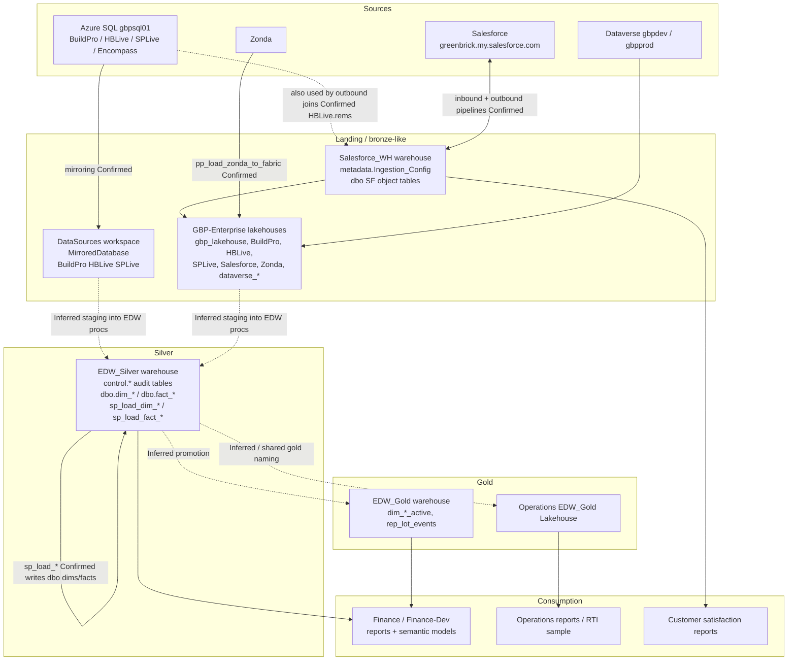

# Data lineage overview

**Documented:** 2026-07-15  
**Evidence:** live Fabric item inventory, pipeline definitions, warehouse catalogs, Salesforce config SQL  
**Policy:** solid lines = Confirmed; dashed / labeled Inferred where transform ownership is not yet proven in a pipeline definition

---

## End-to-end map



---

## Domain swimlanes

### A. ERP / SQL mirrors (Confirmed)

```
gbpsql01 (BuildPro, HBLive, SPLive)
  -> DataSources.*MirroredDatabase (+ SQLEndpoint)
  -> (Inferred) staging consumed by EDW_Silver sp_load_* 
  -> EDW_Silver dbo.dim_* / fact_*
```

Encompass exists on SQL but has **no** DataSources mirror (Confirmed gap).

### B. Salesforce bidirectional (Confirmed)

```
Salesforce_Prod connection
  <- pp_fabric_salesforce_ingestion_prod (Outbound from Salesforce_WH dbo views)
  -> pp_salesforce_fabric_ingestion_prod (Inbound truncate+load into Salesforce_WH.dbo)
Driven by Salesforce_WH.metadata.Ingestion_Config
Orchestrated by pp_salesforce_orchestrator_prod
  then pp_load_view_to_csv
```

Inbound objects land in `Salesforce_WH.dbo` (Account, Lot__c, WorkOrder, ...).  
Outbound pushes Lots / Vendors / Vendor_Lot / PO_* into Salesforce objects.

### C. EDW orchestration (Confirmed)

```
pp_orchestration_without_pp_audit  (active 15-min Cron)
  inlines dbo.sp_load_dim_* / sp_load_fact_* on EDW_Silver

pp_orchestration_with_pp_audit / pp_orchestration_full
  InvokePipeline to variant child pipelines (disabled or on-demand)
```

Control plane: `EDW_Silver.control.audit_*`.

### D. Gold and reporting (mixed)

| Asset | Confidence |
|---|---|
| `EDW_Gold` active dims / `rep_lot_events` | Confirmed objects |
| Silver → Gold transform pipeline | **Not found**; promotion Inferred |
| Finance semantic models / reports | Confirmed consumers in Finance workspaces |
| Operations `EDW_Gold.Lakehouse` | Confirmed item; feed path Inferred |

---

## Entity lineage inside EDW_Silver (Confirmed targets)

**Dimensions:** company, date, division, job, job_task, lot, major_minor, operating_unit, period, project, sale, sale_transfer, sgm_map  

**Facts:** general_ledger, lot_financials (+ hist), lot_sgm (+ hist), sgm_assumptions (+ hist)

Each has a matching `sp_load_*` except date (proc exists; dedicated pipeline not observed).

---

## Orchestrated load order (from InvokePipeline orchestrators)

Typical child order in `pp_orchestration*` families:

1. dim_job_task  
2. dim_sale_transfer  
3. dim_job  
4. dim_sale  
5. dim_lot  
6. dim_major_minor  
7. fact_general_ledger  
8. dim_sgm_map  
9. fact_lot_financials  
10. dim_company  
11. dim_division  
12. dim_period  
13. dim_operating_unit  
14. dim_project  
15. (+ fact_sgm_assumptions / fact_lot_sgm on audit/full variants)

`pp_orchestration_without_pp_audit` executes the equivalent SP sequence inline rather than via child pipelines.

---

## Open lineage questions

1. Exact staging objects/schemas read inside each `sp_load_*` (need proc body review in `EDW_Silver`).  
2. Job/process that builds `EDW_Gold` `*_active` tables.  
3. Whether Finance models bind to Silver, Gold, or both.  
4. Zonda and Dataverse paths into EDW vs staying in lakehouses only.

Next technical step for (1): `OBJECT_DEFINITION` / proc script export for `sp_load_dim_company` and `sp_load_fact_lot_financials`.

Update 2026-08-05: the full end to end lineage of the live 15 minute orchestrator (trigger, audit envelope, exact 16 proc DAG with dependencies and load types, targets, failure paths, quirks) is documented in `orchestrator-e2e.md`. Note the section 123 load order below reflects the dormant InvokePipeline orchestrators; the live orchestrator calls `sp_load_*` procs directly.

Estate catalog (Microsoft Purview) is planned, not provisioned. See
[`knowledge/operations/purview-catalog.md`](../operations/purview-catalog.md).
Purview will not replace this map for table-level IPE lineage.
