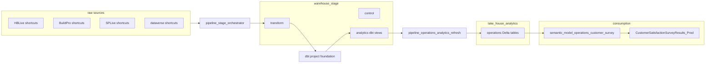

# Operations analytics (Foundation Development)

**Updated:** 2026-08-25  
**Workspace:** Foundation Development (`40502864-6ece-49b5-807f-6f7c11d1b3e1`)  
**dbt project:** `foundation`  
**Status:** Running on schedule; analytics owned by dbt (analytics-first)

## Architecture



| Layer | Object | Role |
|---|---|---|
| Transform | `warehouse_stage.transform.*` | Conformed entities (loads via `pipeline_stage_orchestrator`) |
| Analytics | `warehouse_stage.analytics.*` | dbt views (project `foundation`) |
| Operations | `lake_house_analytics.operations.*` | Materialized tables for reports and semantic models |

## Naming (D13)

- Fabric workspace stays **Foundation Development** (deployment pipeline pairing).
- Tool artifacts spelled out: `pipeline_*`, `lake_house_*`, `warehouse_*`, `semantic_model_*`.
- Table shape markers kept: `obt`, `det`, `sum`, `hist`, `map`.
- No `EDW_*`, `dim_`, `fact_`, `vw_`, or tool acronyms `pl_` / `lh_` / `wh_` / `sm_` in new work.

## Workspace folders

Foundation Development is divided by layer. **Analytics is the presentation layer** (finalized consumption only). Domain departments nest under `analytics`. Platform tooling stays in `utilities`.

| Folder | Role | Contents |
|---|---|---|
| `raw` | Landed source shortcuts | `HBLive`, `BuildPro`, `SPLive`, `dataverse_gbpdev`, `lake_house_zonda`, `lake_house_buildermetrix` (D18; empty until vendor connection), `lake_house_web` (D19 Firecrawl spike; see [`web-scrape-setup.md`](web-scrape-setup.md)) |
| `stage` | Conformed warehouse + load orchestration | `warehouse_stage`, `pipeline_stage_orchestrator`, `pipeline_stage_wave_runner` |
| `analytics` | Presentation layer (finalized only) | Nested department folders |
| `analytics/operations` | Operations department presentation | ops lakehouse, CustSat SM/report, CustSat data agent (see `copilot-custsat-poc.md`), lot events, ops sales SMs/reports, `variable_library_operations` |
| `analytics/finance` | Finance department presentation | Executive and weekly semantic models / reports |
| `analytics/Title` | Title department presentation | `semantic_model_title_booking` |
| `analytics/HR` | HR department presentation | Empty (ready for consumption artifacts) |
| `analytics/Marketing` | Marketing department presentation | Empty (ready for consumption artifacts) |
| `analytics/Mortgage` | Mortgage department presentation | Empty (ready for consumption artifacts) |
| `analytics/Land` | Land department presentation | Empty (ready for consumption artifacts) |
| `analytics/IT` | IT department presentation | Empty (ready for consumption artifacts) |
| `analytics/Builders` | Builder presentation root | One folder per homebuilder operating unit |
| `utilities` | Platform tooling (not presentation) | refresh / harvest / sql runner / scratch / dbt job / activators / backup cleanup / Zonda load |
| `utilities/salesforce` | Salesforce integration (not presentation) | `warehouse_salesforce`, `lake_house_salesforce`, SF pipelines, SF activator |

Builder folders under `analytics/Builders` (HomeBuilder operating units, confirmed 2026-08-12): The Providence Group, CB JENI Homes, Centre Living Homes, Southgate Homes, GHO Homes, Trophy Signature Homes Dallas, Trophy Signature Homes Houston, Trophy Signature Homes Austin, Normandy Homes. Same tree exists in Foundation (prod twin), empty except FD Title SM.

Do not put unfinished work or platform jobs directly in `analytics`.

## Artifact IDs (Foundation Development)

| Artifact | ID |
|---|---|
| `warehouse_stage` | `45471114-769a-4d8f-a0b7-24168e62293c` |
| `lake_house_analytics` Lakehouse | `14e9cfcb-8d62-4d71-9379-08c52d938c3c` |
| `lake_house_analytics` SQLEndpoint | `8caa5865-eb2d-4df0-b521-ad5bf46afc57` |
| `lake_house_buildermetrix` Lakehouse | `9f3fe55b-b89b-4213-af3c-7aaebc0561fe` |
| `lake_house_web` Lakehouse | `0b979032-a5d7-4cdb-a6bd-8b2a6964378f` |
| `notebook_web_scrape` | `8093b7c6-926a-4fce-bacd-59d73732521c` |
| `notebook_web_listings` | `52dd7d90-da4a-4457-9107-5c60e97beb96` |
| `pipeline_web_scrape` | `01a78eb2-c176-4604-88bb-974700cb991d` |
| `pipeline_operations_analytics_refresh` | `48f66f40-087f-4f99-a2c0-38ecfa13f6b9` |
| `pipeline_stage_orchestrator` | `d8333786-2b28-4c61-86fd-597e512d2de9` |
| `pipeline_sql_runner` | `9de78734-19df-4686-bb33-019631ecaef1` |
| `variable_library_operations` | `1ec0cdce-7b37-441b-bc69-cc7d185294de` |
| `semantic_model_operations_customer_survey` | `9fb9e4f8-369a-4a6a-a439-c49b820760c1` |
| `semantic_model_operations_web_listings` | `a5893487-02fe-4d8e-ac78-2dec40d3adca` |
| `report_operations_web_listings` | `79c9e17e-bc41-4387-bd5e-38a423a0c28a` |
| `semantic_model_operations_competitor_analysis` | `116ecabc-0bd0-4253-ba6c-f637dbfe4efd` |
| `report_operations_competitor_analysis` | `8079c0ec-35a1-4af3-bc09-5165097645cd` |
| `data_agent_operations_customer_survey` | `b3061a00-caa4-4207-943f-2445b42612a1` |
| `CustomerSatisfactionSurveyResults_Prod` Report | `9fdfa39b-edbd-45f3-aee1-e69e0db479f8` |
| `data_build_tool_job_foundation` | `7260a513-a312-45ba-8b4d-0f3271dee41b` |

SQL endpoint host: `cx2knzbh2yrejngvheequwseqy-mqufaqgon22utad7n56bdunt4e.datawarehouse.fabric.microsoft.com`

## Pipelines

| Pipeline | Schedule | Behavior |
|---|---|---|
| `pipeline_stage_orchestrator` | Every 15 min, Central | Guard + audit + one ordered ForEach over `control.stage_load_config` (~9 activities) |
| `pipeline_operations_analytics_refresh` | Every 15 min, Central (12 min offset) | Copies active rows from `control.analytics_refresh_config` into `lake_house_analytics` |

Config: [`automation/sql/analytics_refresh_config.sql`](../../automation/sql/analytics_refresh_config.sql)  
dbt project: [`dbt/`](../../dbt/)

## Materialized tables (operations domain)

Current-row entities: `calendar`, `company`, `division`, `operating_unit`, `fiscal_period`, `major_minor`, `plan`, `project`, `lot`, `job`, `job_task`, `sale`, `sale_transfer`.

Consumption: `lot_obt`, `sale_obt`, `lot_events_obt`, `lot_financials_obt`, `lot_financials_det`, `sales_sum_weekly`, `unit_sum_weekly`, `sales_sum_monthly`, `customer_survey_obt`, `customer_survey_response_statistical_det`, `customer_survey_statistical_sum`, `customer_survey_statistical_det`, `customer_survey_comment_det`, `customer_survey_theme_det`, `customer_survey_voc_sum`, `customer_survey_voc_review_det`, `unit_budget_hist`, `web_listing_obt`, `web_community`, `web_plan`, `web_lot`, `competitor_listing_obt`, `competitor_community_obt`.

`*_active` twins are not published. Semantic models filter current-row entities (the views already restrict `is_active = 'Y'`).

### customer_survey_obt

Additive rebuild of Operations `CustomerSatisfactionSurveyResults_Prod` as one big table. **Operations workspace was not modified.**

| Piece | Location |
|---|---|
| dbt model | [`dbt/models/analytics/customer_survey_obt.sql`](../../dbt/models/analytics/customer_survey_obt.sql) |
| View | `warehouse_stage.analytics.customer_survey_obt` |
| Lakehouse table | `lake_house_analytics.operations.customer_survey_obt` |
| Dataverse shortcuts (Foundation Development only) | `dataverse_gbpdev` shortcuts to Enterprise survey tables |

## Deploy notes

- Prefer `dbt run` when ODBC Driver 18 + Entra CLI auth works against `warehouse_stage`.
- Fallback: `dbt/deploy_via_sql_runner.sh` renders models and deploys through `pipeline_sql_runner`.

## dbt schedule (DEV)

- Fabric item `data_build_tool_job_foundation` is pointed at `warehouse_stage` / `analytics` with the `foundation` project uploaded (replaced the jaffle sample).
- Fabric REST/`fab job` still reject `DBTItem` schedule and start (`InvalidJobType` / invalid path). Run from the Fabric UI, or locally/CI via [`automation/run_dbt_analytics.sh`](../../automation/run_dbt_analytics.sh) (`dbt run --select analytics`).
- `pipeline_operations_analytics_refresh` remains on a 15-minute cron after stage (materialize views to lakehouse).

## CustSat semantic model (DEV)

**Evaluation (2026-08-31):** Live `semantic_model_operations_customer_survey` was a hybrid: `customer_survey_obt` Import from `lake_house_analytics.operations.customer_survey_obt` plus ~76 legacy star-schema tables (`FACT_gbp_reponse`, `DIM_*`, `vw_dim_*_active`, bridge tables, `DIM_Measures`, `DIM_Date`, many `LocalDateTable_*`). Only two measures lived on the OBT table; ~120 KPI measures stayed on `DIM_Measures` and referenced the fact table. Compare to `semantic_model_operations_sales`, which is OBT-only (`sale_obt` + measures).

**OBT rebuild (2026-08-31, staged, not yet deployed):** `automation/rebuild_custsat_semantic_model.py` produces a lean model:

| Table | Role |
|---|---|
| `customer_survey_obt` | Lakehouse Import + all CustSat DAX (migrated from `DIM_Measures`) |
| `calendar` | Time intelligence (`operations.calendar`) |
| `PeriodTable`, `DateTypeTable`, `MinGoal`, `MaxGoal`, `KPIStatusColorTable` | Slicers / KPI bands (unchanged calculated tables) |
| `Survey Name`, `Survey Status` | Matrix helpers for survey-rate visuals |

Legacy tables are dropped. Date logic uses `calendar[full_date]` with inactive relationships on `survey_sent_on` and `lot_close_date`. Lender / construction-manager bridge measures (`Selected Lender`, `Selected CM`) return blank until those attributes are added to the OBT.

**Empty semantic model (2026-08-31):** The lakehouse table is populated (`SELECT COUNT(*) FROM operations.customer_survey_obt` returned 112,694 rows). Import mode loads at refresh time. Two refresh blockers were found:

1. **Column types:** `lot_id` and `project_id` are `varchar` in the lakehouse (for example `00011552_0840509`) but the SM had `int64`. Fixed in `rebuild_custsat_semantic_model.py` (`OBT_COLUMN_TYPES`).
2. **Cloud connection:** Refresh still fails until the SM uses an explicit Fabric cloud connection (not the default anonymous SQL connection). In Fabric: semantic model **Settings** → **Data source connections** → bind **Foundation Development Lake** (`86e291b0-…`) or **Foundation Development Lake Analytics** (`8edf1d35-…`) on host `…-mqufaqgon22utad7n56bdunt4e…` / database `lake_house_analytics` with organizational credentials, then **Refresh now**.

**Model join design (OBT):** Do not add star-schema relationships to `sale`, `lot`, `project`, or `operating_unit` tables. Those joins already happen in dbt (`customer_survey_obt.sql`). The semantic model should contain:

| Object | Join to OBT? | Purpose |
|---|---|---|
| `customer_survey_obt` | (fact) | All dimensions and measures |
| `calendar` | Yes (3 date columns; one active) | Time intelligence (`DATESYTD`, `USERELATIONSHIP` for Date Type slicer) |
| `PeriodTable`, `DateTypeTable` | No (disconnected) | Slicer values read by DAX (`SELECTEDVALUE`) |
| `MinGoal`, `MaxGoal`, `KPIStatusColorTable` | No | KPI band / conditional-format helpers |
| `Survey Name`, `Survey Status` | No | Survey-rate matrix row/column headers |

Active relationship: `survey_completed_on` → `calendar.full_date`. Inactive: `survey_sent_on`, `lot_close_date` (activated in measures when Date Type is Survey Sent or Close Date).

Staged output: `fabric/build/custsat_obt_sm/`. Deploy (after `az login` MFA refresh):

```bash
python3 automation/rebuild_custsat_semantic_model.py
```

Use `--dry-run --local` to rebuild from `/tmp/custsat-sm-eval` without Fabric API. The script also rebinds `report_operations_customer_survey` field references from legacy entities to `customer_survey_obt`.

**Prior binding notes (2026-08-10):**

- Dims / `sale_active`: `lake_house_analytics.operations.*` on the FD SQL host
- Survey tables: `dataverse_gbpdev` on the FD SQL host (shortcuts to Enterprise gbpprod survey tables)

**Refresh gate:** API refresh fails until the model uses an explicit cloud connection (not the default anonymous SQL connection). In Fabric: semantic model settings → data source connections → bind `lake_house_analytics` on the FD SQL host (`...-mqufaqgon22utad7n56bdunt4e...`) with organizational credentials. Re-run gateway bind after deploy (`rebind_analytics_sms.py` pattern).

## Related artifacts (2026-08-10)

| Item | Location | Notes |
|---|---|---|
| `report_operations_sales` | Foundation Development `analytics/operations` | New 2026-08-18. Pipeline + Detail pages on `sale_obt` |
| `semantic_model_operations_sales` | same | Full `sale_obt` grain + Sale Count / Approved / Cancelled / Avg Sqft |
| `report_operations_web_listings` | Foundation Development `analytics/operations` | Summary, Detail, Map on `web_listing_obt` (includes Avg PPSF). Inventory dump. FD only. |
| `semantic_model_operations_web_listings` | same | Current web scrape snapshot + inventory map |
| `report_operations_competitor_analysis` | same | Overview / Community / Plans / Inventory. Website list vs GBP ERP SGM. |
| `semantic_model_operations_competitor_analysis` | same | `competitor_listing_obt` + `competitor_community_obt` |
| `report_operations_customer_survey` | Foundation Development `analytics/operations` | Restyled 2026-08-19 to match Finance executive grid (150x88 cards, GRBK logo). Detail page added 2026-08-25 on `customer_survey_obt` (buyer, lot, comments). FD only. |
| `semantic_model_operations_customer_survey` | same | OBT rebuild staged 2026-08-31 (`customer_survey_obt` + calendar + slicer helpers; legacy star schema removed). Deploy via `rebuild_custsat_semantic_model.py`. |
| `report_finance_executive_dashboard` | Foundation Development `analytics/finance` | GBP Foundation Flat v3 dual-rail on `lot_events_obt`. Period slicer MTD/QTD/YTD plus calendar as-of (2026-09-19 local rebuild). FD only. |
| `semantic_model_finance_executive_dashboard` | same | Event-type unit/revenue measures with Central as-of. Local TMDL in `fabric/build/finance_executive`. Live update blocked 2026-09-19 (no dataset write). |
| Operations `CustomerSatisfactionSurveyResults_Prod` report | Operations | Layout restored 2026-08-19 from GBP-Enterprise original (KPI / Question / Survey Rate / Community). Still bound to Operations SM `a559f2de-…`. Semantic model was not changed. |
| Operations `CustomerSatisfactionSurveyResults_v2` report | Operations | New 2026-08-25 (`510fc0eb-…`). Copy of Prod; FD executive layout + Detail. Bound to the same SM `a559f2de-…`. Prod report was not replaced. |

## Finance presentation tranche (2026-08-11)

**Live in FD** (created 2026-08-11). D13 names, rebound to
`lake_house_analytics.operations.*`, Import mode. Finance prod was
not overwritten (D12).

| Target | Id | Source |
|---|---|---|
| `semantic_model_finance_executive_unit_dashboard` | `b740b6fc-a691-4ebd-ae29-bc000a236f58` | Finance `Executive Unit Dashboard` |
| `report_finance_executive_unit_dashboard` | `95f9df6d-2292-4eaf-89ca-3fe11c32a4bc` | |
| `semantic_model_finance_weekly_sales` | `134db12d-7986-41b7-a531-2d4d95963107` | Finance-Dev `Optimized Weekly Sales Report` |
| `report_finance_weekly_sales` | `ad611139-f24b-4b0a-8640-f90e4f9bbcc4` | |
| `semantic_model_finance_weekly_unit` | `faf32c38-008c-4191-afa6-bdfe08bb0b75` | Finance-Dev `Optimized Weekly Unit Report` |
| `report_finance_weekly_unit` | `fb3151aa-2d81-4536-8cc6-8d2b7fc32bd3` | |

**Cloud connections:**

- **FD (2026-08-19):** Executive dashboard SM rebound to `lot_events_obt`
  and bound to **Foundation Development Lake Analytics**
  (`8edf1d35-…`, WorkspaceIdentity) on FD host / `lake_house_analytics`.
  Refresh Completed (Sales 25,526 / Closings 24,933 / Starts 26,792).
- **FD (2026-08-11):** Unit + Weekly SMs still on **Foundation Development Lake**
  (`86e291b0-…`) whose SQL catalog is still `lake_house_operations_analytics`.
  CustSat bound to FD Lake + FD dataverse.
- **Foundation twin (2026-08-12 second promote):** all four Finance SMs
  (Exec + Unit + Weekly Sales + Weekly Unit) host-rewritten to Foundation SQL
  host and bound to **Foundation Lake** (`73fac61d-894a-4dd8-909a-99d369f2b026`,
  WorkspaceIdentity). In `analytics/finance`. Refresh not run (build-only).
- **Foundation CustSat (2026-08-12):** host rewritten to Foundation SQL host;
  bound to Foundation Lake + **Foundation dataverse_gbpdev**
  (`8e7c07b9-4280-4181-a324-6fb4b19671fb`).
- **New presentation SMs (FD 2026-08-12):** lot events, title booking, ops sales
  (see [`presentation-subjects.md`](../analytics/presentation-subjects.md)).
- **Pipeline health:** `analytics.pipeline_health_obt` view deployed; dbt model
  `pipeline_health_obt`; no schedule.

Zonda tranche: see [`zonda-setup.md`](zonda-setup.md). Promoted to Foundation
2026-08-12 (schedule OFF).

Web scrape spike: see [`web-scrape-setup.md`](web-scrape-setup.md). Foundation
Development `lake_house_web` Files plus `analytics.web_listing_obt` published
to `lake_house_analytics.operations`. Schedule OFF.

Notebook create fix: API payloads must set `definition.format=ipynb` (otherwise
Fabric defaults to `fabricGitSource` and fails with `PyToIPynbFailure`). Fixed in
`automation/retry_finance_zonda_build.py`.


## Deployment pipeline (2026-08-10)

Fabric deployment pipeline **Foundation** pairs **Foundation Development** (Development) → **Foundation** (Production). Pipeline ID `369a8272-7267-4161-a634-9bd34ac8e99e`. **No content was deployed** to Foundation on setup day; Foundation workspace stayed empty. See [`deployment-pipeline.md`](deployment-pipeline.md).

## Budgets (2026-08-10)

| Item | Detail |
|---|---|
| Source (confirmed) | `GBP-Enterprise` / `EDW_Silver.dbo.UnitBudgets2025` |
| Profile | 1008 rows; 7 ounits; stats `Starts` / `Sales` / `Closings` / `Net Revenue`; dates 2025-01-01..2027-12-01 |
| FD targets | `warehouse_stage.transform.unit_budget_hist`, `analytics.unit_budget_hist`, `lake_house_analytics.operations.unit_budget_hist` |
| Refresh | On-demand: `python3 automation/load_unit_budget_hist.py` (harvest + `transform.sp_load_unit_budget_hist`). Not on the 15-minute orchestrator. |
| Non-producer | `LotMultiBudget` notebook reads `HBLive.rems.jobbudgets` (lot cost budgets); not copied as budget producer |

## GBP-Enterprise vs Foundation Development (live inventory 2026-08-10)

Confirmed via `fab ls`: GBP-Enterprise **171** items; Foundation Development **23** items. Approach is D13 additive rebuild in FD, not a 1:1 workspace clone.

| Enterprise class | Count | FD status |
|---|---:|---|
| `stage_pipelines` | 75 | Partial: replaced by `pipeline_stage_orchestrator` + `pipeline_stage_wave_runner` |
| SQL endpoints | 14 | Review / auto with lakehouses |
| Dataflows | 14 | Deferred |
| Notebooks | 13 | Deferred (LotMultiBudget not a UnitBudgets producer) |
| Other presentation | 12 | Partial: Finance + CustSat SMs/reports in FD |
| Salesforce | 12 | Deferred |
| Raw source lakehouses | 6 | Partial: BuildPro / HBLive / SPLive / dataverse shortcuts in FD |
| Reflexes | 5 | Deferred |
| Zonda | 5 | Deferred |
| Other pipelines | 5 | Review |
| CustSat presentation | 4 | Replaced in FD |
| Capacity monitoring | 3 | Deferred |
| `EDW_Silver` / `EDW_Gold` | 2 | Partial: `warehouse_stage` + dbt analytics + ops lakehouse |

### FD coverage (confirmed)

Stage warehouse, ops analytics lakehouse, scratch, source shortcuts, stage orchestrator/wave runner, harvest, sql runner, analytics refresh, CustSat + Finance semantic models/reports, `unit_budget_hist`.

### Next deferred tranche

Zonda, Reflexes, Dataflows, capacity Eventhouse. No `EDW_*` / `pp_*` names in new FD work.

**Gold → dbt (all domains, 2026-08-10):** Full map of 37 `EDW_Gold` views → `foundation` dbt analytics → ops lakehouse is in [`knowledge/analytics/gold-to-dbt-map.md`](../analytics/gold-to-dbt-map.md). Not Finance-only: domains `shared`, `operations`, `finance`, `title`. Refresh with `pipeline_operations_analytics_refresh` `p_domain=all`.

**Salesforce (2026-08-10):** Additive FD rebuild under D13 names. See [`knowledge/pipelines/salesforce-fd.md`](../pipelines/salesforce-fd.md). Outbound to Salesforce_Prod disabled in FD config.

## Known follow-ups

- Column-name parity checks for Finance dims (`calendar` vs legacy `vw_dim_date`) after FD refresh
- Transform `sp_load_*` migration into dbt (later phase)
- Shared presentation lakehouse is `lake_house_analytics` (D15)
- Finance prod cutover only with explicit instruction
- `unit_budget_hist` producer is `automation/load_unit_budget_hist.py` (on-demand, not 15-min)
