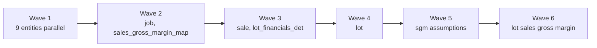

# Orchestrator rebuild: table-driven stage loads

**Documented:** 2026-08-05  
**Replaces:** `pp_orchestration_without_pp_audit` plus the entire dormant wrapper fleet (65 pipelines) and the 3 dormant orchestrator variants  
**Detailed design for:** rearchitecture Phase 3 (`rearchitecture.md` section 4.2)  
**Confirmed inputs:** live orchestrator definition (`lineage/orchestrator-e2e.md`), orphan scan, rename map

---

## 1. The problem being fixed

The current estate encodes orchestration in pipeline definitions, so every change is a pipeline edit and every variant is a copy:

1. 65 wrapper pipelines exist solely to wrap 21 procs in 4 to 6 load-type variants. All are dead (orphan scan); the live orchestrator bypasses them and hard-codes 16 proc calls with dependencies drawn as activity wiring.
2. Load behavior is invisible: `LoadType` comes from a variable that is never set (procs silently receive empty string), except two hard-coded surprises (`dim_sale_transfer` TRUNCATE & LOAD, `dim_period` FULL, every 15 minutes).
3. Adding an entity means editing the orchestrator definition: add a proc activity, wire dependencies, add a failure SetVariable, extend the concat expression. Sixteen entities already produce a definition too large to review.
4. Per-proc policy (10 minute timeout, zero retries) is frozen in the definition.

Target: **orchestration is data, not definitions.** Adding, reordering, disabling, or changing the load type of an entity is an INSERT or UPDATE to one control table. Pipeline count for the entire stage refresh: **two**.

## 2. Design

### 2.1 One table drives everything: `control.stage_load_config`

Already seeded (`automation/sql/stage_load_config.sql`); this design adds the orchestration columns:

| Column | Purpose |
|---|---|
| `target_name`, `proc_name_target` | What to load and how (also the rename map) |
| `default_load_type` | Explicit per entity: `AUTO` (proc watermark logic), `FULL`, `TRUNCATE_LOAD`. No more empty strings |
| `run_group` | `standard` (15 min cadence) or `history` (on demand) |
| `run_wave` | **NEW: dependency encoding.** Integer wave; wave N starts only after wave N-1 completes. Entities within a wave run in parallel |
| `timeout_minutes` | NEW: per-entity activity timeout (current global 10 min becomes a column) |
| `retry_count` | NEW: per-entity retries (current 0 becomes a deliberate choice) |
| `is_active` | Disable an entity without deleting anything |

### 2.2 Dependency encoding: waves, derived from the confirmed DAG

The live DAG (Confirmed in `orchestrator-e2e.md`) collapses cleanly into six waves:

| Wave | Entities (parallel within wave) |
|---|---|
| 1 | `company`, `division`, `operating_unit`, `major_minor`, `fiscal_period`, `project`, `job_task`, `sale_transfer`, `general_ledger` (+ `calendar`, seeded inactive) |
| 2 | `job`, `sales_gross_margin_map` |
| 3 | `sale`, `lot_financials_det` |
| 4 | `lot` |
| 5 | `sales_gross_margin_assumptions_det` |
| 6 | `lot_sales_gross_margin_det` |

Why waves and not an edge table: a true edge-based DAG executor cannot be expressed natively in Fabric pipeline activities (no dynamic dependency wiring), so edge tables end up needing a T-SQL driver loop that serializes execution or a far more complex Until-loop pipeline. Waves keep the table trivially readable, match the real DAG exactly today, and cost at most a small synchronization delay (an entity waits for its whole predecessor wave, not just its named parents; with a 15 minute cadence and sub-minute procs this is noise). If a future graph stops collapsing into waves, revisit with an edge table then, not now.

### 2.3 One simple pipeline (simplified 2026-08-27)

**History:** The 2026-08-06 build unrolled waves 1..8 into a **25-activity ribbon** because ForEach cannot nest and workspace-identity InvokePipeline failed with `UserAccessTokenException`. That canvas was far too complex.

**Current design (Foundation Development):**

**`pipeline_stage_orchestrator`** (~9 activities):
1. Guard: Lookup `RUNNING` count; IfCondition with only a Fail if a prior run is still open (before audit insert).
2. Audit start: generate `orchestrator_audit_id`, INSERT `RUNNING`.
3. One Lookup: all active `control.stage_load_config` rows for `p_run_group`, **`ORDER BY run_wave, target_name`**.
4. One sequential ForEach: execute `schema_name.proc_name_target` with `JobRunId` / `LoadType` / `OrchestratorAuditId`.
5. Audit end: SUCCESS or FAILED (+ Fail).

Wave dependencies stay correct because entities run in `run_wave` order. Within-wave parallelism was dropped so the canvas stays readable (Invoke child jobs still cannot start without a user token). Add/disable/reorder entities only in the config table. Redeploy: `python3 -u automation/simplify_stage_orchestrator.py`.

**`pipeline_stage_wave_runner`**: optional on-demand parallel run of a single wave. Not called by the scheduled orchestrator.

Parameters on the orchestrator give the remaining variants for free:
- `p_run_group = 'history'`: replaces `pp_fact_hist_scheduled` and its 3 children.
- `p_load_type_override = 'FULL'`: replaces `pp_orchestration_full` and all 14 `_full` wrappers.
- Default run: replaces the live orchestrator, `pp_orchestration`, `pp_orchestration_with_pp_audit`, and 48 more wrappers.

### 2.4 What deliberately stays the same

1. The 21 `sp_load_*` procs and their `JobRunId / LoadType / AuditId / OrchestratorAuditId` contract. Zero proc logic changes at cutover (renames come later, Phase 5).
2. The `control.*` audit tables and the parallel-run guard semantics.
3. The 15 minute cadence and Central time.
4. The failure Reflex (repointed to the new pipeline, sent to the distribution list per Phase 1).

### 2.5 Day-2 operations become row operations

| Task | Today | After |
|---|---|---|
| Add entity | Edit orchestrator definition: activity + wiring + failure variable + concat | `INSERT INTO stage_load_config` (proc must exist) |
| Disable entity | Edit definition, redeploy | `UPDATE ... SET is_active = 0` |
| Full rebuild of one entity | Run its `_full` wrapper (dormant, untested) | Run `pl_stage_wave_runner` manually for that entity with override, or flip `default_load_type` for one cycle |
| Full rebuild of everything | `pp_orchestration_full` (dormant since December) | Run orchestrator with `p_load_type_override = 'FULL'` |
| Change dependency order | Rewire activities | `UPDATE ... SET run_wave = n` |
| Change timeout/retry | Edit every activity | `UPDATE` one column |

## 3. Open decisions this design surfaces

| ID | Question | Recommendation |
|---|---|---|
| D8 | `dim_sale_transfer` TRUNCATE & LOAD and `dim_period` FULL every 15 minutes: intentional requirements or legacy accidents? | Seed them as-is (`TRUNCATE_LOAD`, `FULL`) to preserve behavior at cutover, then review with the team; the config makes changing it a one-column UPDATE |
| D9 | Retry policy: current is 0 retries, 10 minute timeout, alert on first failure | `retry_count = 1` with 10 minute timeout for standard entities; transient warehouse contention should not page anyone at 3 AM |

## 4. Validation and cutover (fits rearchitecture Phase 3)

1. Build both pipelines and the extended config table in GBP-Enterprise-Dev.
2. Parallel run against the live orchestrator for at least one week; compare per-run row counts and `audit_sp_control` outcomes per entity per cycle.
3. ~~Confirm the empty-LoadType question~~ **Confirmed 2026-08-05 from proc text**: every `sp_load_*` proc contains `IF @LoadType = ''` followed by watermark logic (`MAX(lastmoddatetime)`, or FULL when the target is empty). `AUTO` in the config translates to passing empty string, which is exactly what the live orchestrator does. `default_load_type = 'AUTO'` is a faithful translation.
4. Cutover: disable the old schedule, enable the new one in the same maintenance window; keep the old orchestrator disabled for two weeks as rollback.
5. Then delete: 3 dormant orchestrators, 65 wrappers, and the old live orchestrator. Stage pipeline count: 90 to 2 (plus the Salesforce family and utilities per the rearchitecture).

## 5. Seed changes

`automation/sql/stage_load_config.sql` updated in this same change: added `run_wave`, `timeout_minutes`, `retry_count`; explicit `default_load_type` per entity (`TRUNCATE_LOAD` for `sale_transfer`, `FULL` for `fiscal_period`, `AUTO` elsewhere, pending D8).

## 6. Build status in Foundation Development (2026-08-05)

Deployed and confirmed working:

1. `wh_stage.Warehouse` fully provisioned via `pl_sql_runner` (local TDS access to Fabric warehouses stopped working; SQL now executes through a utility pipeline, and `pl_harvest_edw` copies query results from `EDW_Silver` into `lh_scratch` for local reads via OneLake).
2. `control` schema: exact production DDL for all 7 audit and validation tables plus the 2 performance views, harvested live from `EDW_Silver.INFORMATION_SCHEMA` and `sys.sql_modules`.
3. `dbo` schema: all 20 production stage tables (empty), skipping legacy `dim_job_task1`, `dim_job_task2`, `UnitBudgets2025`.
4. All 26 procs created with `EDW_Silver.` self-references rewritten to local schema references. Originals archived at `automation/sql/edw-silver-procs/`.
5. `sp_load_dim_date` signature standardized in the dev copy to the common contract (`@LoadType`, `@AuditId`, `@OrchestratorAuditId` added as ignored optional params); the production copy only accepts `(@CreatedBy, @JobRunId)`.
6. `pl_stage_wave_runner` validated end to end standalone: config lookup, parallel ForEach, and proc invocation all work (tested with `calendar` active in wave 1).
7. InvokePipeline parameter format fixed: Fabric rejects the `{value, type: Expression}` wrapper inside InvokePipeline `parameters`; plain expression strings required.

**End-to-end run confirmed 2026-08-06**: full orchestrator run completed with `calendar` active in wave 1. `control.audit_orchestrator_control` shows the SUCCESS row (and a correctly recorded FAILED row from an earlier attempt), and `dbo.dim_date` loaded 7,671 rows (2016-01-01 to 2036-12-31). Guard, audit envelope, wave lookups, parallel proc execution with retry, and both failure and success audit paths all verified against live runs.

**Full production-shaped run confirmed 2026-08-06 (all 17 entities)**: sources were wired into Foundation Development as four schema-enabled shortcut lakehouses (`HBLive`, `BuildPro`, `SPLive`, `dataverse_gbpdev`; 56 table shortcuts to the GBP-Enterprise lakehouses), `tbl_Milestones` (75 rows) copied over, and every standard entity activated. The orchestrator ran all six waves in about 13.5 minutes: 16 of 16 procs SUCCESS in `control.audit_sp_control`, `AUTO` correctly resolved to FULL against empty targets, `sale_transfer` ran TRUNCATE & LOAD, slowest proc was `sp_load_fact_general_ledger` at 193 seconds (25.8M rows). Row count comparison vs `EDW_Silver`: exact match on truncate-and-load and static tables; SCD2 tables show fewer rows in dev as expected, since production accumulates row versions (for example `dim_job_task` 166M prod vs 6.9M current-state dev, confirming the history bloat found in the orphan scan). Proper parity checks during the Phase 3 parallel-run week should compare current-state rows only (`is_active` / open `effective_end_date`), not raw counts.

**Schema cutover 2026-08-06 (Foundation Development):** warehouse schemas are now `raw`, `stage`, `control`, `transform`, `analytics`. Business tables and load procs live in `transform` under the naming-standard names (`transform.company`, `transform.sp_load_company`, etc.). `dbo` business objects were dropped. Orchestrator looks up `schema_name + '.' + proc_name_target`. Analytics: 30 of 37 former gold views deployed to `analytics.*` (7 deferred: depend on gold-only objects or missing SPLive tables). Proc sources: `automation/sql/transform-procs/`.

The InvokePipeline connection saga that led to the single-pipeline redesign, kept for the record: the shared `gbp-data-pipeline` connection carries a named user's OAuth credential (Akshaya Dhanraj, no access to this workspace). A workspace-identity connection was created, the identity was added to a new `GB Fabric API Users - Workspace Identities` security group, and both service principal tenant settings (`ServicePrincipalAccessGlobalAPIs`, `ServicePrincipalAccessPermissionAPIs`) were scoped to include it. That fixed authentication, but the invoked child then failed with `UserAccessTokenException`: Fabric cannot start pipeline jobs from an app-only token, period. Hence no InvokePipeline. The group and tenant scoping remain in place and are useful for any future service principal API automation; the connection itself was deleted.

Source dependencies for later phases: procs read cross-database from `HBLive.rems.*`, `BuildPro.dbo.*`, `SPLive.dbo.*`, and `dataverse_gbpdev.dbo.*` (note: production procs read the dev-named Dataverse database). Running real loads in Foundation Development requires schema-enabled lakehouses with shortcuts mirroring those names, or a config-driven source remap during Phase 3.
