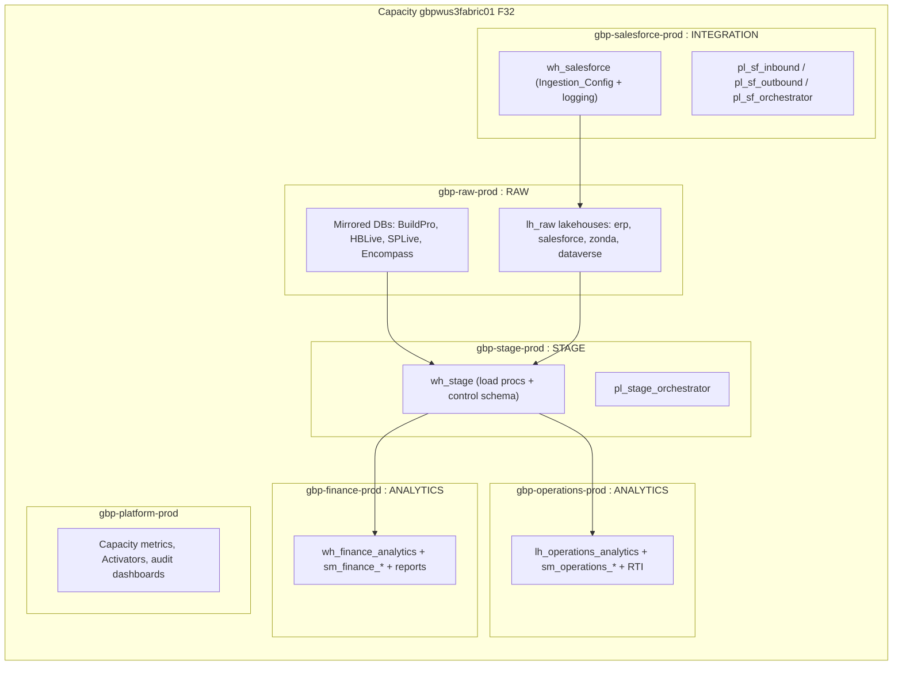

# Green Brick Fabric re-architecture proposal

**Documented:** 2026-07-15 (revised same day for raw / stage / analytics layers and the descriptive table naming standard)  
**Author:** Green Brick Fabric Architect (Foundation project)  
**Inputs:** `inventory/environment.md`, `workspace-map/workspaces.md`, `architecture/overview.md`, `pipelines/*`, `lineage/overview.md`  
**Evidence policy:** Current-state statements are Confirmed from live Fabric CLI, warehouse SQL, and Azure CLI unless labeled Inferred. Target-state content is proposal.

Layer vocabulary used throughout: **raw** (landed source data), **stage** (conformed, integrated), **analytics** (consumption ready). Medallion terms are not used in target-state design; where current-state artifacts carry names like `EDW_Silver` those names are quoted as-is because they exist in the live estate.

---

## 1. Executive summary

The platform works: a 15 minute EDW refresh runs reliably, the Salesforce bidirectional sync is healthy, and a layered shape (raw lakehouses, a conformed warehouse, consumption stores) already exists in embryo. The problems are structural, not functional:

1. **One giant workspace.** GBP-Enterprise holds 171 items spanning raw, stage, analytics, orchestration, and alerting. Layer boundaries exist only by naming convention.
2. **Pipeline sprawl.** 90 pipelines in prod, of which 65 are copies of the same wrapper in 4 to 6 variants per entity, plus bkp1 / test / UAT / old items living in production.
3. **Opaque naming.** Tables named `dim_*` and `fact_*`, views named `vw_*`, warehouses named after layers nobody outside the team recognizes. A reader cannot tell what a table holds without opening it.
4. **No delivery process.** Dev and prod are hand-synchronized twins (identical 90 pipeline names). No git integration in the working workspaces; GitTest exists but is unused.
5. **Schedule and alert debt.** 4 enabled-but-expired schedules, duplicate Salesforce naming families, alerts wired to individual mailboxes.
6. **Identity debt.** SQL auth connection names, a personal ADLS connection, and SQL public network access enabled despite private endpoints.

The proposal: keep the stored procedure logic and audit plane (they are the healthy part), and rebuild the packaging around them: domain workspaces with enforced raw / stage / analytics boundaries, a single descriptive naming standard for every table and view, a metadata-driven load framework that collapses 65 wrapper pipelines to roughly 3, git-based promotion, and workspace identity for all connections. Migration is staged in six phases; nothing requires a big-bang cutover.

---

## 2. Object naming standard (applies to all new work)

### 2.1 Rules

1. **No `dim_`, `fact_`, or `vw_` prefixes. Ever.** Views follow exactly the same naming rules as tables.
2. **Plain descriptive names.** Anyone reading the name should know what the object holds without opening it. Spell subjects out in full; legacy name-length limits are long gone.
3. **Pattern:** `<subject>[_<qualifier>]_<shape>[_<period>]`
4. **Shape markers** (suffix, lowercase):

| Marker | Meaning | Example |
|---|---|---|
| `obt` | One big table, fully denormalized for consumption | `lot_sales_obt` |
| `sum` | Summary or aggregate grain | `sales_sum_weekly` |
| `det` | Detail or transaction grain | `job_cost_det` |
| `hist` | Point-in-time history / snapshots | `project_budget_hist` |
| `map` | Bridge or crosswalk between subjects | `community_region_map` |

5. **Reference entities carry no shape marker.** Former dimensions become plain entity names: `company`, `project`, `community`, `job_task`, `calendar`.
6. **Period suffix always last** when the grain is time bound: `weekly`, `monthly`, `daily`, `quarterly`. Example: `sales_sum_weekly`, not `weekly_sales_sum`.
7. **Stored procedures** name their target: `sp_load_<object>` (`sp_load_company`, `sp_load_sales_sum_weekly`).
8. **Schemas** carry the layer or function: `raw`, `stage`, `analytics`, `control`, `logging`, `metadata`.

### 2.2 Rename mapping (examples from the confirmed estate)

The complete authoritative mapping now lives in `rename-map.md` (drafted 2026-08-04 from the live OneLake inventory), with the machine-readable seed in `automation/sql/stage_load_config.sql`. These confirmed objects illustrate the standard:

| Current (Confirmed) | Target |
|---|---|
| `dim_company` | `company` |
| `dim_project` | `project` |
| `dim_job_task` (+ abandoned `dim_job_task1`, `dim_job_task2`) | `job_task` (single table, copies deleted) |
| `dim_date` | `calendar` |
| `fact_*` transaction tables | `<subject>_det` |
| `fact_*_hist` snapshots | `<subject>_hist` |
| Weekly sales measures behind `sm_finance_weekly_sales` | `sales_sum_weekly` |
| `dim_*_active` tables in the consumption store | `<entity>` plus an `is_active` filter, or `<entity>_active` if a separate table earns its keep |
| `vw_*` views | Same rules, no prefix; a view over detail filtered to open jobs is `job_open_det`, not `vw_open_jobs` |

Semantic models keep the `sm_<domain>_<subject>` rule (`sm_finance_sales_weekly`), pipelines keep `pl_*`, notebooks keep `nb_*`.

---

## 3. Current state assessment (Confirmed)

### 3.1 What is healthy

| Area | Evidence |
|---|---|
| EDW core | `EDW_Silver.dbo.sp_load_*` procs with consistent `JobRunId / LoadType / MaxDateTime / AuditId` contract |
| Audit plane | `control.audit_pipeline_control`, `audit_orchestrator_control`, `audit_sp_control`, `audit_step_control` in active use |
| Salesforce sync | Config-driven via `Salesforce_WH.metadata.Ingestion_Config`; healthy runs at 10 / 13 / 16 Central; per-table logging |
| Source mirroring | BuildPro, HBLive, SPLive mirrored from `gbpsql01` into DataSources |
| Capacity | Single F32 (`gbpwus3fabric01`), all workspaces bound, active |
| Network | VNet, private DNS, private endpoints for SQL already provisioned |

### 3.2 Structural problems

| # | Problem | Evidence |
|---|---|---|
| P1 | Layers collapsed into GBP-Enterprise (13 lakehouses, 11 warehouses, 90 pipelines, reports, eventhouse in one workspace) | workspace-map |
| P2 | 65 of 90 pipelines are entity wrappers duplicated per variant (base / audit / full / no_audit / hist) | edw-deep-dive |
| P3 | Non-production items in prod: `_bkp1`, `_test`, `_UAT`, `_old`, `pp_temp_schema_discovery`, `puheader_test`, `dim_job_task1 / 2`, 10+ abandoned Dataflows staging stores | catalog, warehouse SQL |
| P4 | Opaque object names throughout: `dim_* / fact_* / vw_*` prefixes, layer-named warehouses | warehouse SQL, catalogs |
| P5 | Dev is a manual mirror of prod (same 90 names); no git integration; no deployment pipelines | all-pipelines-index |
| P6 | Two Salesforce naming families (`pp_fabric_salesforce_ingestion_*` outbound and `pp_salesforce_fabric_ingestion_*` inbound) that read as near-duplicates | salesforce doc |
| P7 | Schedule debt: 4 enabled-but-expired (audit cleanup, mirror compare, fact hist, dim project); mixed time zones including India Standard Time on a prod utility | schedule-truth-table |
| P8 | Alerts email individuals (randerson, adhanraj, kradhakrishnan); one Reflex binds to the wrong-looking artifact | schedule-truth-table |
| P9 | Identity debt: connections named `GB Azure SQL Authentication`, personal `ADLS kradhakrishnan`; `gbpsql01` public network access Enabled despite private endpoints; June outage was `DMTS_EntityNotFoundOrUnauthorized` on the Salesforce connection | environment, fail logs |
| P10 | Gaps: Encompass not mirrored; `sp_load_dim_date` has no pipeline; stage to analytics promotion mechanism unidentified; Audit workspace exists only as Dev | lineage, workspace-map |

---

## 4. Target architecture

### 4.1 Workspace topology

One capacity (F32 stays until Capacity Metrics says otherwise). Workspaces become domain plus layer scoped, per the naming rule `gbp-<domain>-<env>`:

| Target workspace | Layer | Contents (migrated from) |
|---|---|---|
| `gbp-raw-prod` | Raw | DataSources mirrors + source lakehouses (BuildPro, HBLive, SPLive, Salesforce, Zonda, dataverse_*) from GBP-Enterprise |
| `gbp-stage-prod` | Stage | `EDW_Silver` warehouse becomes `wh_stage`; stage orchestrator and loaders |
| `gbp-salesforce-prod` | Integration | `Salesforce_WH` becomes `wh_salesforce`; Salesforce pipelines, view-to-csv |
| `gbp-finance-prod` | Analytics | `EDW_Gold` warehouse becomes `wh_finance_analytics`; Finance semantic models and reports |
| `gbp-operations-prod` | Analytics | Operations consumption lakehouse becomes `lh_operations_analytics`; variable library, RTI items |
| `gbp-audit-prod` | Governance | Audit lakehouse and RBAC notebooks (promoted from Audit-Dev) |
| `gbp-platform-prod` | Ops | Capacity metrics, Activators (Reflexes), monitoring reports |
| `gbp-<domain>-dev` | each | Dev twin per workspace, git-connected |

Each prod workspace gets a matching dev workspace; GitTest retires.

Inferred judgment: Salesforce integration earns its own workspace because it has its own warehouse, config plane, external SaaS connection, and independent cadence. If team size argues for fewer workspaces, it can fold into raw.

### 4.2 Pipeline consolidation: metadata-driven loads

The Salesforce side already proves the pattern: one inbound and one outbound pipeline driven by `Ingestion_Config`. The stage layer should adopt the same design instead of 65 wrappers.

**Detailed design (2026-08-05): `orchestrator-rebuild.md`.** It refines this section using the confirmed live DAG: dependencies are encoded as waves in `stage_load_config` (`run_wave` column), and the replacement is two pipelines (`pl_stage_orchestrator` + `pl_stage_wave_runner`) rather than the three sketched below, with history loads and FULL rebuilds handled by parameters instead of separate pipelines.

**New control table** in `wh_stage`: `control.stage_load_config`

| Column | Example |
|---|---|
| target_name | `company` |
| shape | `entity` / `det` / `sum` / `hist` |
| proc_name | `dbo.sp_load_company` |
| default_load_type | `AUTO` (watermark decides) / `FULL` / `TRUNCATE & LOAD` |
| watermark_source | table or `NONE` |
| execution_order | 10 |
| is_active | Y |
| run_group | `standard` / `history` |

**Replacement pipelines (3 replace 65 + 6 orchestrators):**

| New pipeline | Replaces | Behavior |
|---|---|---|
| `pl_stage_entity_load` | all base / audit / full / no_audit wrappers | Parameters: `p_target`, `p_load_type`, `p_orchestrator_audit_id`; single-target call with audit Scripts |
| `pl_stage_orchestrator` | `pp_orchestration*` (4 variants) | Lookup `stage_load_config` where run_group = standard, ForEach ordered, Invoke `pl_stage_entity_load`; parameter `p_load_type_override` gives FULL rebuild behavior, removing the need for a separate full orchestrator |
| `pl_stage_history_load` | `pp_fact_hist_scheduled` + 3 hist loaders | run_group = history |

Salesforce renames for clarity, logic unchanged:

| New name | Current |
|---|---|
| `pl_sf_inbound` | `pp_salesforce_fabric_ingestion_prod` |
| `pl_sf_outbound` | `pp_fabric_salesforce_ingestion_prod` |
| `pl_sf_orchestrator` | `pp_salesforce_orchestrator_prod` |
| `pl_sf_views_to_csv` | `pp_load_view_to_csv` |

Utilities kept and renamed (`pl_audit_cleanup`, `pl_mirror_compare`, `pl_zonda_load`, `pl_logs_cleanup`). Everything suffixed `_bkp1`, `_test`, `_old`, `_UAT`, plus `pp_temp_schema_discovery`, is deleted from prod (git history becomes the backup).

**Resulting prod pipeline count: about 12, from 90.** Stored procedure logic is unchanged in this step; procs get renamed to `sp_load_<new table name>` as part of the table rename wave (Phase 5), not before.

### 4.3 Table and proc rename wave

Renaming every `dim_* / fact_* / vw_*` object touches procs, semantic models, and reports, so it rides the workspace migration rather than happening in place:

1. Phase 3 builds `control.stage_load_config` with both `current_name` and `target_name` columns; this table becomes the authoritative rename map.
2. Phase 5 recreates stage tables in `wh_stage` under target names as each domain migrates; procs are renamed to `sp_load_<target_name>` in the same change set, applied through git.
3. Phase 6 builds analytics objects (`*_obt`, `*_sum_*`) new-named from day one; nothing with a `dim_ / fact_ / vw_` prefix is ever created in an analytics store.
4. Report and semantic model rebinds are the last step per domain, with a rebind checklist per model.
5. No compatibility views. Old names die when the domain cuts over; anything still referencing them is found in dev during parallel run, not papered over in prod.

### 4.4 Orchestration and scheduling

| Job | Schedule | Notes |
|---|---|---|
| `pl_stage_orchestrator` | Cron 15 min Central | Successor of `pp_orchestration_without_pp_audit`; keeps `control.audit_orchestrator_control` envelope including the existing previous-run-in-progress guard |
| `pl_sf_orchestrator` | Daily 10:00 / 13:00 / 16:00 Central | Unchanged cadence |
| `pl_stage_history_load` | On demand | Replaces expired nightly hist schedule; run after month-end or backfills |
| `pl_audit_cleanup`, `pl_mirror_compare`, `pl_logs_cleanup` | Daily / 2h, all Central | Renew explicitly or retire; no enabled-but-expired states allowed |

Rules: one scheduler per process, all schedules Central time, every schedule reviewed at creation with an explicit end date policy (either none or a documented sunset).

### 4.5 Analytics and reporting layer

1. Analytics store per domain: Finance keeps a Warehouse (`wh_finance_analytics`), Operations keeps a Lakehouse (`lh_operations_analytics`).
2. Build the missing stage to analytics promotion as explicit `pl_<domain>_analytics_refresh` pipelines (or notebooks with Delta MERGE) so consumption tables have an owned, observable producer. Today their producer is unidentified (Confirmed gap).
3. Analytics tables follow the naming standard in section 2: wide denormalized consumption tables are `*_obt`, aggregates are `*_sum_<period>`, transaction grain is `*_det`.
4. Semantic models renamed `sm_<domain>_<subject>` (`sm_finance_sales_weekly`, `sm_operations_lot_events`); the 8+ optimization experiments in Finance-Dev get consolidated to one published model per subject with the rest archived.
5. Report usage metrics and best-practice-analyzer artifacts move to `gbp-platform-prod`.

### 4.6 Security and identity

| Item | Action |
|---|---|
| SQL connections (`GB Azure SQL Authentication` family) | Replace with Workspace Identity where supported, else a service principal with secret in `gb-fabric-keyvault`; never embedded SQL auth |
| `ADLS kradhakrishnan` | Replace with workspace-owned connection; personal connections banned in prod |
| Salesforce connections | Keep `Salesforce_Prod` / `Salesforce_UAT` split; document owner and rotation runbook (June outage root cause was connection resolution, `DMTS_EntityNotFoundOrUnauthorized`) |
| `gbpsql01` public network access | Disable; private endpoints and DNS already exist (Confirmed provisioned) |
| Alerting | All Activator emails to a distribution list (for example `fabric-alerts@greenbrickpartners.com`), never individuals |
| RBAC | Promote Audit-Dev RBAC notebooks to `gbp-audit-prod`; run drift detection on a schedule; workspace roles assigned to security groups only |

### 4.7 DevOps and promotion

1. Connect every dev workspace to Azure DevOps git (`fab` supports git integration; ADO MCP available in this environment).
2. Folder layout in repo mirrors workspace per domain; pipeline definitions, notebook sources, and warehouse DDL (procs) all versioned.
3. Promotion dev to prod via Fabric deployment pipelines or `fab deploy` automation from the Foundation `automation/` folder; no manual prod edits.
4. `snapshots/` remains the disaster-recovery net: nightly `export-fabric-live.sh` (finish the fix so `latest` points at a complete snapshot).
5. Warehouse code (procs, control tables) managed as SQL scripts in git; changes applied through a versioned migration pipeline rather than portal edits.

### 4.8 Observability

1. Keep `control.*` audit plane as the source of truth; add a small `sm_platform_pipeline_health` semantic model + report in `gbp-platform-prod` over `audit_pipeline_control` and `audit_orchestrator_control`.
2. One Activator per orchestrator on ItemJobFailed to the distribution list; retire the mis-bound `act_job_event_failure_alerts` or rebind it explicitly.
3. Capacity watch: monthly review of the Capacity Metrics report before considering F32 changes.

---

## 5. Gap analysis (current to target)

| Dimension | Current | Target |
|---|---|---|
| Workspaces | 10, layer-mixed, legacy names | 14 domain workspaces (7 prod + 7 dev), `gbp-<domain>-<env>` |
| Layer vocabulary | Medallion-flavored names in stores | raw / stage / analytics everywhere |
| Table naming | `dim_* / fact_* / vw_*` prefixes | Descriptive names with obt / sum / det / hist / map markers and period suffixes |
| Prod pipelines | 90 (65 variant wrappers) | ~12 metadata-driven |
| Orchestrators | 6 overlapping | 3 (`stage`, `sf`, `history`) |
| Schedules | 2 active, 4 expired-enabled, 6 disabled, mixed TZ | All Central, none expired-enabled |
| Promotion | Manual dev/prod mirroring | Git plus deployment pipeline |
| Connections | SQL auth names, personal ADLS | Workspace Identity / Key Vault backed |
| Alerts | Individual mailboxes | Distribution list |
| Analytics producer | Unidentified | Owned `pl_<domain>_analytics_refresh` per domain |
| Encompass | On SQL only | Mirrored or documented exclusion |
| Audit | Dev only | `gbp-audit-prod` with scheduled drift detection |

---

## 6. Migration plan

Phases ordered so each is independently valuable and reversible. Prod cutovers ride the existing 15 minute and daily cadences, so windows are small.

### Phase 0: Baseline (prerequisite, low risk)
- Finish `export-fabric-live.sh` run to completion; point `snapshots/latest` at a full snapshot.
- Commit knowledge folder and snapshot manifest to git.
- Exit: complete definitions for all 11 workspaces on disk.

### Phase 1: Hygiene (low risk, no data path changes)
- Delete `_bkp1` / `_test` / `_old` / `pp_temp_schema_discovery` from prod (post-snapshot).
- Fix schedule debt: renew or disable the 4 expired-enabled jobs; move `pp_delete_blocked_logs` to Central.
- Repoint all Activator emails to the distribution list; rebind or retire `act_job_event_failure_alerts`.
- Drop `puheader_test`, review `dim_job_task1 / 2`, archive abandoned Dataflows staging stores.

### Phase 2: Delivery rails (medium risk)
- Git-connect GBP-Enterprise-Dev (as-is names) to ADO; establish deployment pipeline dev to prod.
- Move warehouse procs and control DDL into the repo.
- Exit: a change reaches prod only through git.

### Phase 3: Pipeline consolidation (medium risk, biggest payoff)
- Create `control.stage_load_config` including the `current_name` to `target_name` rename map for every table, view, and proc.
- Build `pl_stage_entity_load`, `pl_stage_orchestrator`, `pl_stage_history_load` in dev.
- Parallel-run against `pp_orchestration_without_pp_audit` in dev comparing `audit_pipeline_control` outcomes for at least one week.
- Cut prod schedule over to `pl_stage_orchestrator`; keep old orchestrator disabled for two weeks, then delete variants.
- Rename Salesforce pipelines to `pl_sf_*` in the same wave.

### Phase 4: Identity and network (medium risk, coordinated windows)
- Replace SQL auth and personal connections with Workspace Identity / Key Vault.
- Disable `gbpsql01` public network access after validating mirror traffic over private endpoints.

### Phase 5: Workspace re-topology and rename wave (higher risk, staged by domain)
- Stand up `gbp-*-prod/dev` workspaces; migrate domain by domain (Operations first as smallest, Finance, then split GBP-Enterprise into raw / stage / salesforce).
- Apply the table, view, and proc renames from `stage_load_config` as each domain migrates; no `dim_ / fact_ / vw_` names cross into new workspaces.
- OneLake shortcuts bridge cross-workspace references during transition.
- Retire legacy workspaces after two clean weeks per domain.

### Phase 6: Analytics layer (medium risk)
- Build `pl_finance_analytics_refresh` / `pl_operations_analytics_refresh` as the owned stage to analytics producers.
- Model consumption tables as `*_obt`, `*_sum_<period>`, `*_det` per the naming standard.
- Consolidate Finance model variants into `sm_finance_*` publications; archive experiments.
- Mirror Encompass or record the exclusion decision.

---

## 7. Decisions required (to record in knowledge/decisions)

| ID | Decision | Recommendation |
|---|---|---|
| D1 | Salesforce integration: own workspace or inside raw | Own workspace |
| D2 | Keep audit-variant behavior as parameter or drop audit Scripts where redundant with `audit_sp_control` | Parameter on `pl_stage_entity_load` |
| D3 | Encompass mirroring | Mirror it; it is already on `gbpsql01` |
| D4 | Finance analytics store type | Keep Warehouse (matches current estate) |
| D5 | Dev data strategy (full copy vs subset) | Subset via config flag in `stage_load_config` |
| D6 | Alert distribution list name and ownership | Platform team owned |
| D7 | Rename map sign-off: final target name per table before Phase 5 | Review `stage_load_config` map as a team; names are permanent |

---

## 8. Risks and mitigations

| Risk | Mitigation |
|---|---|
| Consolidated pipeline hides per-entity failure isolation | Per-target Invoke keeps target-level audit rows and Activator visibility; run_group split limits blast radius |
| Workspace split breaks hard-coded workspaceId / artifactId references (Confirmed pattern in definitions) | Definitions are regenerated through git deploy per environment; shortcuts bridge during migration |
| Table renames break unknown downstream consumers | Rename map published ahead of Phase 5; dev parallel run surfaces breakage; per-domain cutover keeps blast radius small; no silent compatibility views hiding stragglers |
| Connection swap breaks Salesforce sync (see June failures) | Swap in dev first; keep old connection until two clean days of prod runs |
| Public network disable interrupts mirroring | Validate mirror session over private endpoint in a maintenance window; rollback is a single az command |
| Naming migration breaks report bindings | Semantic model renames done last, with report rebind checklist per model |

---

## 9. What deliberately does not change

1. Stored procedure business logic and the `control.*` audit schema (procs get renamed, not rewritten).
2. The `Ingestion_Config` metadata pattern (it becomes the template for the stage layer).
3. F32 capacity and West US 3 region.
4. Mirroring as the ERP ingestion mechanism.
5. The 15 minute stage refresh / three-times-daily Salesforce cadence.
